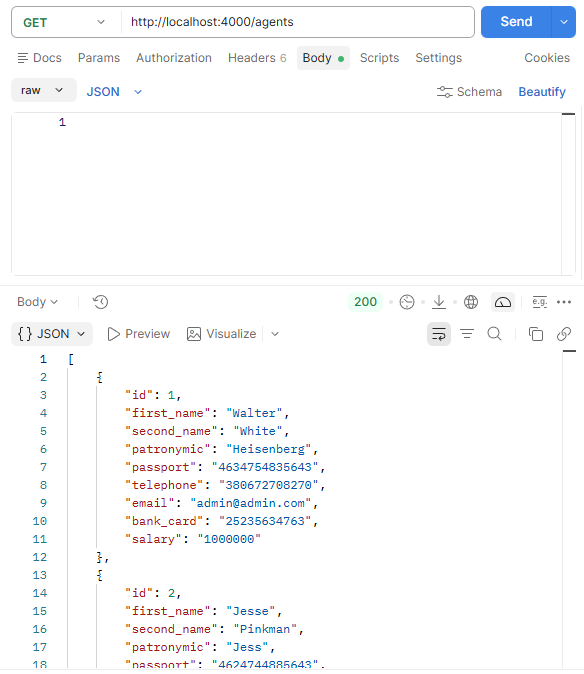
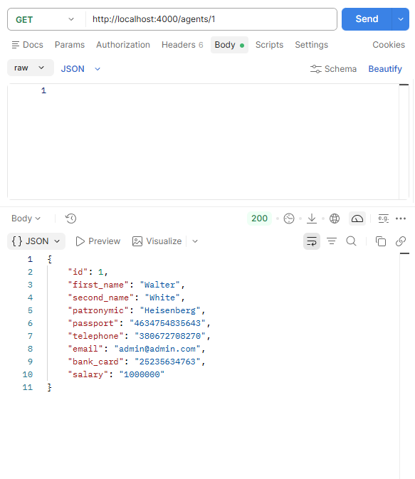
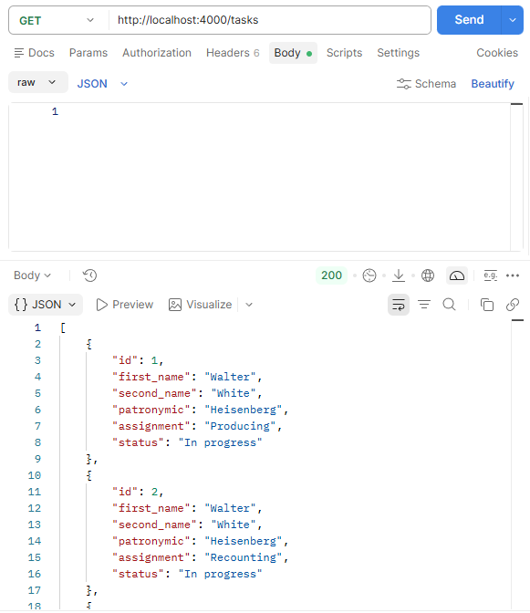
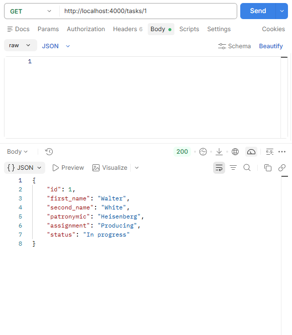
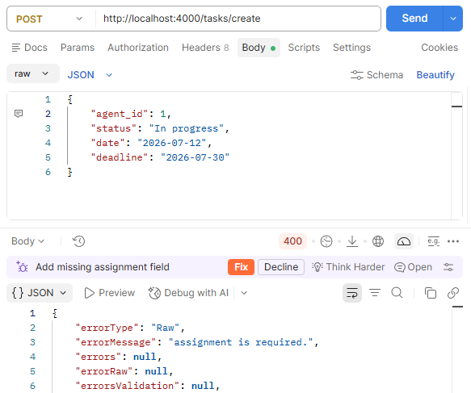

# КПЗ 1

## Сутності

Agent:
- id: number
- first_name: string
- second_name: string
- patronymic: string
- passport: string
- telephone: string
- email: string
- bank_card: string
- salary: string

Task:
- id: number
- agent: ManyToOne з Agent
- assignment: string
- status: string
- date: Date
- deadline: Date

## Ендпоінти

Agents:
- POST /agents/create
- GET /agents
- GET /agents/:id([0-9]+)
- PATCH /agents/:id([0-9]+)
- DELETE /agents/:id([0-9]+)

Tasks:
- POST /tasks/create
- GET /tasks
- GET /tasks/:id([0-9]+)
- PATCH /tasks/:id([0-9]+)
- DELETE /tasks/:id([0-9]+)

## Скріншоти

GET /agents


GET /agents/1


GET /tasks


GET /tasks/1


# КПЗ 2

## Роль кожного шару

Middleware (валідація) — перевіряє запит: дані, авторизацію та права доступу до виконання запиту.

Controller (оркестрація) — приймає запит, викликає потрібні методи Service та повертає HTTP-відповідь.

Service (бізнес-логіка) — реалізує основні правила й операції застосунку.

Repository (доступ до даних) — відповідає за взаємодію з базою даних: читання, створення, оновлення та видалення даних.

## Приклад коду Middleware

agent.ts
```
import { Request, Response, NextFunction } from 'express';
import { isEmpty } from 'validator';
import { CustomError } from 'utils/response/custom-error/CustomError';

export async function agentBodyCheck(req: Request, res: Response, next: NextFunction): Promise<void> {
  const { first_name, second_name, patronymic, passport, telephone, email, bank_card, salary } = req.body;

  if (isEmpty(first_name || '')) {
    return next(new CustomError(400, 'Raw', `first_name is required.`, null, null));
  }

  if (isEmpty(second_name || '')) {
    return next(new CustomError(400, 'Raw', `second_name is required.`, null, null));
  }

  if (isEmpty(patronymic || '')) {
    return next(new CustomError(400, 'Raw', `patronymic is required.`, null, null));
  }

  if (isEmpty(passport || '')) {
    return next(new CustomError(400, 'Raw', `passport is required.`, null, null));
  }

  if (isEmpty(telephone || '')) {
    return next(new CustomError(400, 'Raw', `telephone is required.`, null, null));
  }

  if (isEmpty(email || '')) {
    return next(new CustomError(400, 'Raw', `email is required.`, null, null));
  }

  if (isEmpty(bank_card || '')) {
    return next(new CustomError(400, 'Raw', `bank_card is required.`, null, null));
  }

  if (isEmpty(salary || '')) {
    return next(new CustomError(400, 'Raw', `salary is required.`, null, null));
  }

  return next();
}
```

## Приклад коду ResponseDTO

TaskDTO.ts
```
import { Task } from "orm/entities/Task";

export class TaskDTO {
  id: number;
  first_name: string;
  second_name: string;
  patronymic: string;
  assignment: string;
  status: string;

  constructor(task: Task) {
    this.id = task.id;
    this.first_name = task.agent.first_name;
    this.second_name = task.agent.second_name;
    this.patronymic = task.agent.patronymic;
    this.assignment = task.assignment;
    this.status = task.status;
  }

  static fromMany(tasks: Task[]): TaskDTO[] {
    return tasks.map((task) => new TaskDTO(task));
  }
}
```

## Приклад коду Cервіс-класу

TaskService.ts
```
import { getRepository } from 'typeorm';
import { Task } from "orm/entities/Task";
import { Agent } from "orm/entities/Agent";
import { CustomError } from "utils/response/custom-error/CustomError";

class TaskService {
  private taskRepository = getRepository(Task);
  private agentRepository = getRepository(Agent);

  async create(taskData: { agent_id: number; assignment: string; status: string; date: string; deadline: string }): Promise<Task> {
    const agent = await this.agentRepository.findOne({ where: { id: taskData.agent_id } });

    if (!agent) {
      throw new CustomError(409, 'Raw', `Task agent with id:${taskData.agent_id} not found.`, null, null)
    }

    const realData = {
      agent: agent,
      assignment: taskData.assignment,
      status: taskData.status,
      date: new Date(taskData.date),
      deadline: new Date(taskData.deadline)
    }

    const task = this.taskRepository.create(realData);

    await this.taskRepository.save(task);

    return task;
  }

  async list(): Promise<Task[]> {
    return await this.taskRepository.find({ relations: ['agent'] });
  }

  async show(id: number): Promise<Task> {
    const task = await this.taskRepository.findOne({ where: { id }, relations: ['agent'] });

    if (!task) {
      throw new CustomError(409, 'Raw', `Task with id:${id} not found.`, null, null)
    }

    return task;
  }

  async edit(id: number, taskData: { agent_id: number; assignment: string; status: string; date: string; deadline: string }): Promise<Task> {
    const task = await this.taskRepository.findOne({ where: { id } });

    if (!task) {
      throw new CustomError(409, 'Raw', `Task with id:${id} not found.`, null, null)
    }

    const agent = await this.agentRepository.findOne({ where: { id: taskData.agent_id } });

    if (!agent) {
      throw new CustomError(409, 'Raw', `Task agent with id:${taskData.agent_id} not found.`, null, null)
    }

    task.agent = agent;
    task.assignment = taskData.assignment;
    task.status = taskData.status;
    task.date = new Date(taskData.date);
    task.deadline = new Date(taskData.deadline);

    await this.taskRepository.save(task);

    return task;
  }

  async destroy(id: number): Promise<Task> {
    const task = await this.taskRepository.findOne({ where: { id }, relations: ['agent'] });

    if (!task) {
      throw new CustomError(409, 'Raw', `Task with id:${id} not found.`, null, null)
    }

    await this.taskRepository.delete(id);

    return task;
  }
}

export { TaskService };
```

## Скріншоти

Запит з некоректними даними:


Успішний запит зі структурою ResponseDTO:


# Посилання на репозиторій

[Репозиторій](https://github.com/DialloDan/lab4)